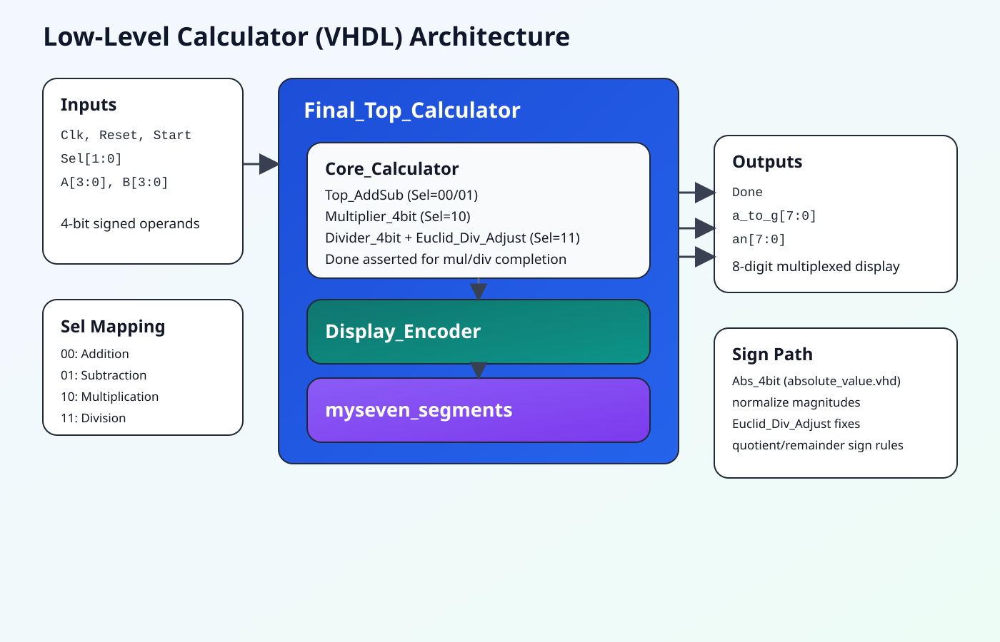

# Low-Level Calculator (VHDL)

A hardware calculator written in VHDL for 4-bit signed operands, with addition, subtraction, multiplication, and division, plus 8-digit seven-segment display output.



## Overview

This project implements a structural top-level design (`Final_Top_Calculator`) that combines:

- Arithmetic core (`Core_Calculator`)
- Result and sign formatting (`Display_Encoder`)
- 8-digit seven-segment scan/display driver (`myseven_segments`)

The calculator accepts signed 4-bit two's-complement inputs and operation select signals, then shows input/output information on the seven-segment display.

## Features

- 4 operations selected by `Sel[1:0]`
- Signed arithmetic for `A` and `B` (`-8` to `+7`)
- Sequential multiplier and divider with `Done` handshake
- Euclidean division: the remainder is never negative (for example, -7 / 2 = -4 remainder 1)
- Division by zero shows `--`
- Vivado project included (`core_calculator.xpr`)
- Self-checking GHDL testbenches (`tests/`)

## Operation Select

| `Sel` | Operation |
|---|---|
| `00` | Addition |
| `01` | Subtraction |
| `10` | Multiplication |
| `11` | Division |

## Display

The eight digits show, from left to right:

| Digit | 8 | 7 | 6 | 5 | 4 | 3 | 2 | 1 |
|---|---|---|---|---|---|---|---|---|
| Shows | sign of A | \|A\| | sign of B | \|B\| | result sign | result tens (quotient for division) | result ones (remainder for division) | operation: `A`, `S`, `M` or `d` |

Sign digits are blank for positive values and `-` for negative ones. Addition and subtraction update as soon as `A`, `B` or `Sel` change; multiplication and division show the result latched when `Done` pulses.

`Start` is active-high: a `1` starts a multiplication or division. If your board's Start button reads `0` when pressed, invert it in `Final_Top.vhd`.

## Top-Level Interface

Entity: `Final_Top_Calculator`

Inputs:

- `Clk`
- `Reset`
- `Start`
- `Sel(1 downto 0)`
- `A(3 downto 0)`
- `B(3 downto 0)`

Outputs:

- `Done`
- `a_to_g(7 downto 0)`
- `an(7 downto 0)`

## Core Architecture

- `Core_Calculator` routes `Start` by `Sel` to add/sub, multiply, or divide.
- Arithmetic path: `Top_AddSub`, `Multiplier_4bit` (iterative FSM), `Divider_4bit` (iterative FSM).
- Division correction: `Euclid_Div_Adjust` fixes quotient/remainder sign behavior.
- Display path: `Display_Encoder` packs `x_inter`, then `myseven_segments` drives `a_to_g` and `an`.

## Project Structure

- `core_calculator.xpr` - Vivado project file
- `core_calculator.srcs/sources_1/imports/FFFinal_Calculator/` - top/core arithmetic and display RTL modules
- `.../Final_Top.vhd` - top-level wrapper
- `.../final_calculator.vhd` - arithmetic core integration
- `.../Display_Encoder.vhd`, `.../myseven_segments.vhd` - display formatting and driver
- `core_calculator.srcs/sim_1/imports/FFFinal_Calculator/Tb_Final_Top.vhd` - simulation testbench
- `core_calculator.srcs/constrs_1/imports/FFFinal_Calculator/main_display_xdc.xdc` - pin constraints
- `tests/` - self-checking GHDL testbenches and `run_tests.sh`

## Build and Run (Vivado)

1. Open Vivado.
2. Open project: `core_calculator.xpr`.
3. Confirm top module is `Final_Top_Calculator`.
4. Run synthesis/implementation and generate bitstream.

Target part in project file:

- `xc7a75tfgg484-1`

## Simulation

### Self-checking tests (GHDL)

```bash
tests/run_tests.sh
```

- `tb_calc_check`: all four operations on all 256 signed `(A, B)` pairs, comparing the displayed sign and digits with reference arithmetic.
- `tb_display_check`: all 8 digits are scanned, sign digits are blank or `-`, and subtraction follows `Sel` without pressing `Start`.

The tests use VHDL-2008 external names to read the encoder output. The script exits with status 1 on any failure; set `GHDL` to use a binary that is not on `PATH`.

### Vivado

1. In Vivado, open Simulation Sources.
2. Use testbench `Tb_Final_Top_Calculator` (`Tb_Final_Top.vhd`).
3. Run behavioral simulation and inspect `Done`, `a_to_g`, and `an`. This testbench drives inputs only and does not check results.

## Notes

- `Done` is meaningful for multiplication and division completion.
- Inputs are treated as signed 4-bit two's-complement values.
- Division includes quotient/remainder correction logic via `Euclid_Div_Adjust`.
